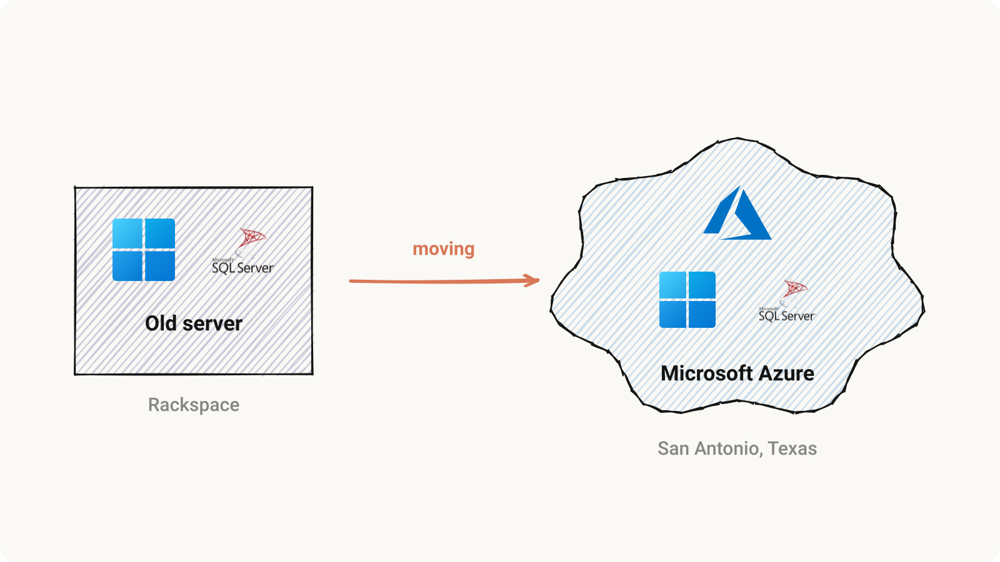
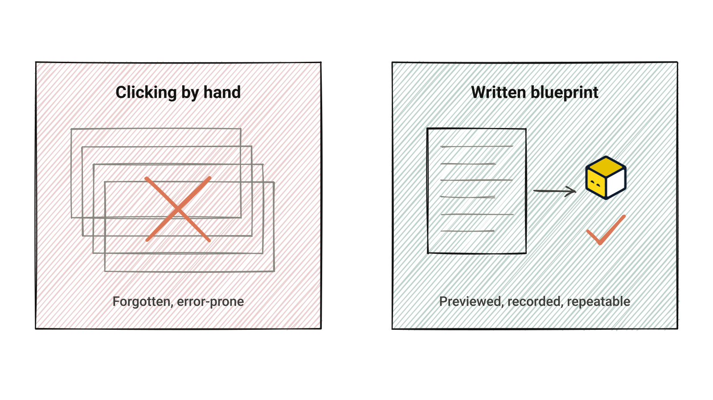
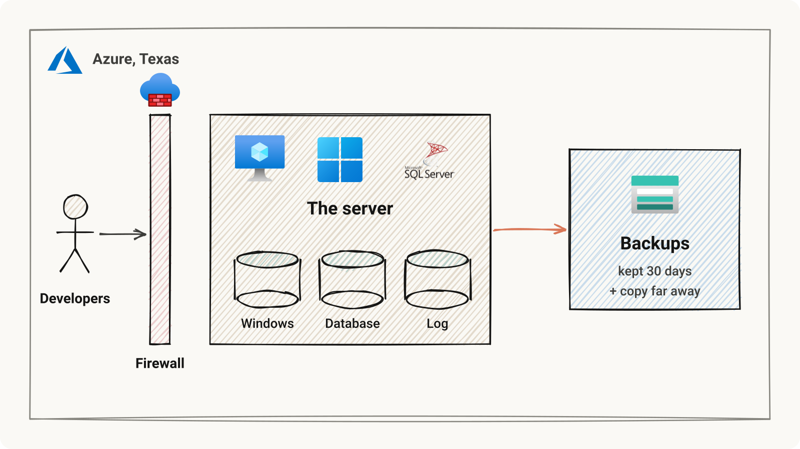
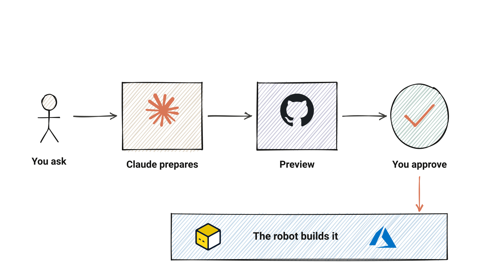
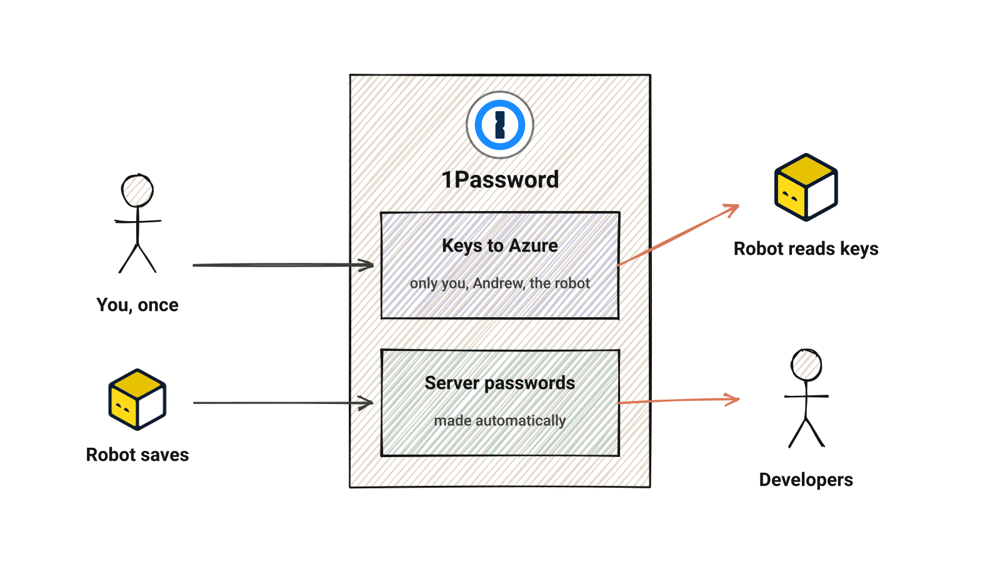
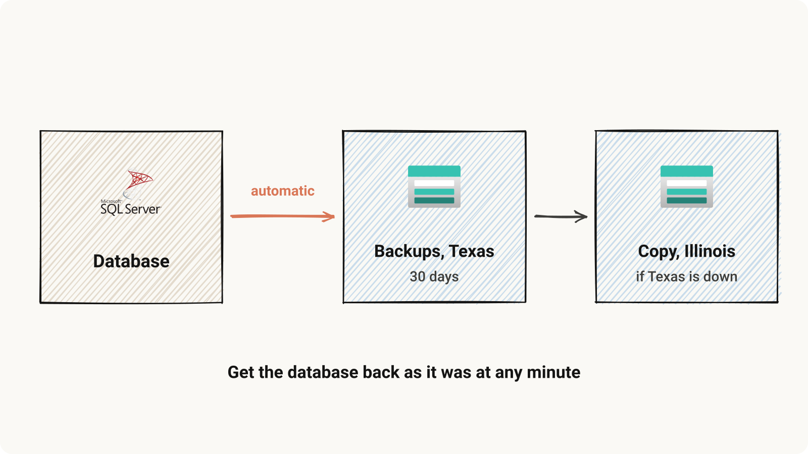
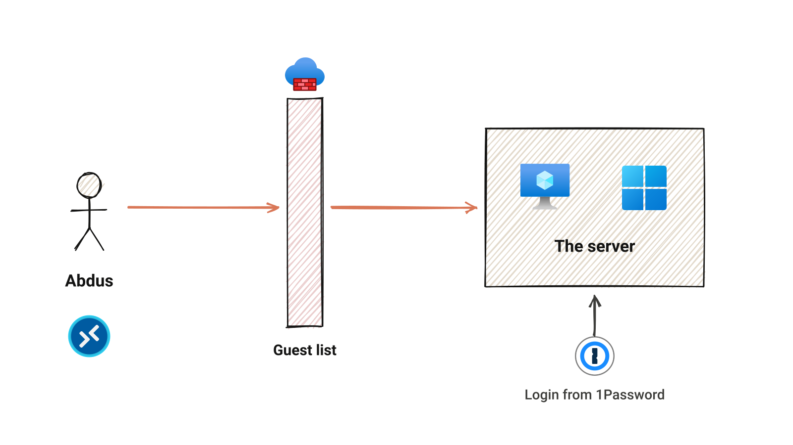
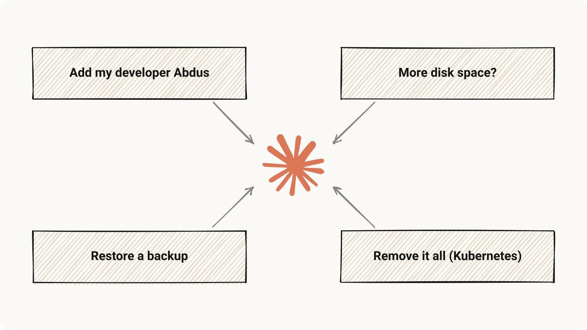
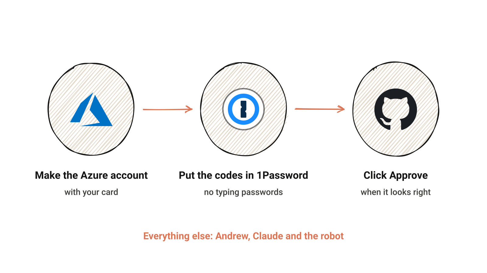
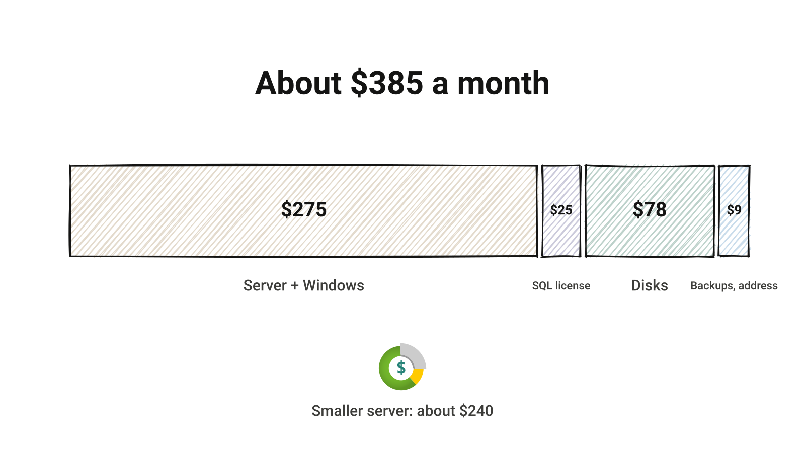

# Our database server, moving to Azure

Note: Press S for the speaker view, F for fullscreen, arrow keys to move. One picture per slide; the notes say it in words.

---

## Written down, not clicked

Note: The whole server is described in a file. A program called OpenTofu (the robot) makes Azure match the description. Every change is previewed first and kept in history.

---

## What we get

Note: One Windows server with SQL Server, three disks, a firewall that only lets in people on the list, and automatic backups kept 30 days with a copy far away.

---

## How a change happens

Note: Nothing changes until you click Approve. Saying no, or asking Andrew, is always safe.

---

## Where the keys live

Note: Passwords never go into GitHub, email or chat. The project is public. Nobody needs to type or remember the server passwords.

---

## Backups, automatically

Note: If something goes wrong, the database can be brought back as it was at almost any minute in the last 30 days.

---

## Letting a developer in

Note: Add the developer's internet address to the guest list, approve, and share the logins vault with them. Claude walks you through it.

---

## Just ask Claude

Note: Open claude.ai/code, pick the azure-infra project, and ask in your own words. Claude explains what would change, the cost, and waits for your yes.

---

## Your part

Note: The step-by-step guide is "Getting started" in the documentation website. Claude can walk you through it.

---

## What it costs

Note: The documentation's Costs page has the details and is kept up to date with the setup.
